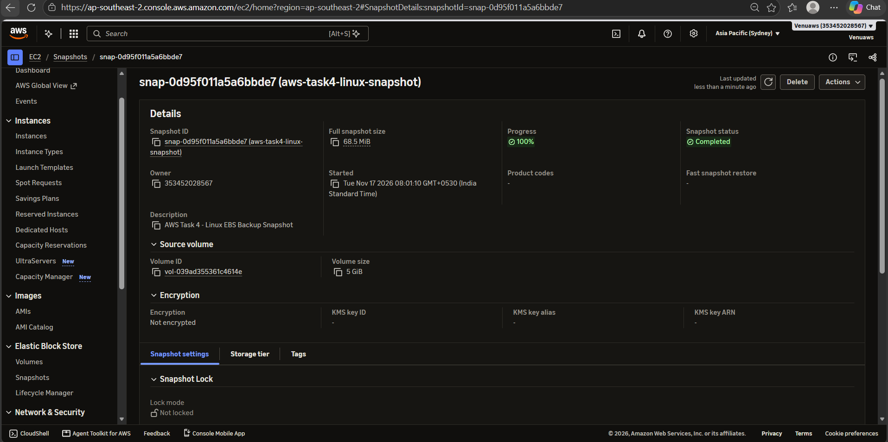

# AWS Task 4 – EC2, Linux, Windows IIS & EBS Snapshot Backup and Recovery

## Project Overview

This project demonstrates AWS EC2 instance deployment, Linux web server configuration, Windows IIS web server deployment, EBS volume management, snapshot backup, and volume restoration.

## Technologies Used

- AWS EC2
- Amazon EBS
- EBS Snapshots
- Linux (Amazon Linux)
- Windows Server
- IIS (Internet Information Services)
- Apache HTTP Server
- SSH / Remote Desktop

## Project Architecture

Two EC2 instances were deployed:

1. Linux EC2 – Configured Apache HTTP Server.
2. Windows EC2 – Configured IIS Web Server.

An additional 5 GiB EBS volume was attached to the Linux instance, formatted with XFS, mounted at `/data`, and used to store test data.

An EBS snapshot was created and restored into a new volume. The restored volume was attached and mounted at `/restore`, and the original test data was successfully verified.

## 1. Linux EC2 Web Server Deployment

- Launched an Amazon Linux EC2 instance.
- Connected through SSH.
- Installed and started Apache HTTP Server.
- Enabled the HTTP service.
- Created a custom HTML welcome page.

### Commands Used

```bash
sudo dnf install httpd -y
sudo systemctl start httpd
sudo systemctl enable httpd
sudo systemctl status httpd

echo "<h1>AWS Task 4 - Linux Web Server</h1>" | sudo tee /var/www/html/index.html
```

### Verification

Access the Linux EC2 public IP using a browser on HTTP port 80.

## 2. Windows EC2 – IIS Web Server

- Launched a Windows Server EC2 instance.
- Connected using Remote Desktop Protocol (RDP).
- Configured Internet Information Services (IIS).
- Verified the default IIS welcome page.
- Tested external browser access.

### Verification

Access the Windows EC2 public IP using a browser.

## 3. EBS Volume Creation and Attachment

Created an additional 5 GiB General Purpose SSD (gp3) EBS volume.

- Attached the volume to the Linux EC2 instance.
- Identified the new disk using `lsblk`.
- Formatted the disk using XFS.
- Created the `/data` mount directory.
- Mounted the volume.

### Commands Used

```bash
lsblk

sudo mkfs -t xfs /dev/nvme1n1

sudo mkdir -p /data

sudo mount /dev/nvme1n1 /data

df -h
```

### Test Data Creation

```bash
echo "AWS Task 4 - EBS Snapshot Backup Test" | sudo tee /data/test.txt

cat /data/test.txt
```

## 4. EBS Snapshot Backup

Created an EBS snapshot from the original volume.

**Snapshot description:** AWS Task 4 - Linux EBS Backup Snapshot

Waited until the snapshot status reached `Completed` (100%).

## 5. Volume Restoration from Snapshot

- Created a new EBS volume using the completed snapshot.
- Selected the same Availability Zone.
- Attached the restored volume to the Linux EC2 instance.
- Identified the restored disk using `lsblk`.

### Mount Restored Volume

```bash
sudo mkdir -p /restore

sudo mount -o nouuid /dev/nvme2n1 /restore

df -h
```

The `nouuid` option allows mounting the restored XFS filesystem alongside the original filesystem, which has the same UUID.

### Data Recovery Verification

```bash
ls -l /restore

cat /restore/test.txt
```

**Expected output:**

```text
AWS Task 4 - EBS Snapshot Backup Test
```

Successfully verified that the original test data was recovered from the EBS snapshot.

## 6. Project Screenshots

### Linux Web Server


### Windows IIS Server


### EBS Volume Management


### Snapshot Backup and Recovery




## 7. Project Outcome

Successfully completed the following:

- Deployed Linux and Windows EC2 instances.
- Configured Apache and IIS web servers.
- Created and attached an additional EBS volume.
- Formatted and mounted an XFS filesystem.
- Created and verified an EBS snapshot.
- Restored a new volume from the snapshot.
- Mounted the restored volume.
- Successfully recovered and verified the original test data.

## Conclusion

This project provided practical experience with AWS EC2 administration, Linux server management, Windows IIS configuration, EBS storage management, and backup and recovery operations.

**Project Status: Completed**
